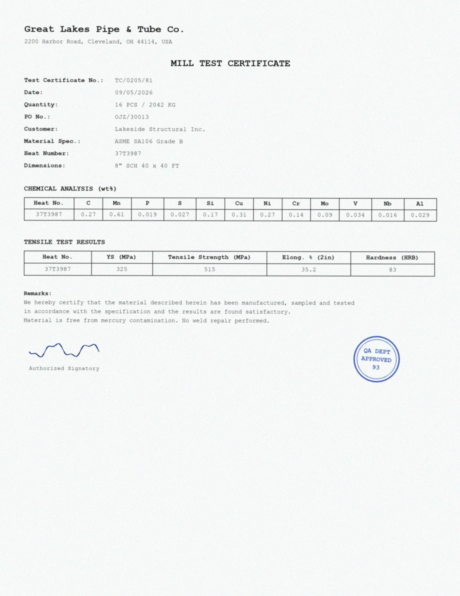

# CertiScan: Material Test Report extraction and compliance checking

Steel mills ship a **Material Test Report (MTR)** with every heat of steel: chemistry, tensile results and
the specification it should meet. Buyers still key these numbers into their ERP by hand and check them
against ASTM limits by eye. CertiScan automates that loop:

```
PDF / scan -> deskew -> YOLOv8 layout detection -> OCR (EasyOCR | Tesseract) -> table + key/value parsing
            (projection     7 regions: title, info,     words + boxes             +- OCR-robust column inference
             profile)       chem table, mech table,                               +- unit normalisation (ksi > MPa)
                            stamp, signature, remarks                             +- cross-field heat-number repair
                                                                                          |
         Flask review UI <-- SQL (dedup by SHA-256) <-- compliance check vs ASTM limits <-+
         (overlay, edit, approve > re-validate)            pass / fail / review / unknown_spec
         JSON + per-heat CSV export for ERP import
```

## Why synthetic data
Real MTRs are customers' documents, and there is no public dataset. `certiscan/synth/generate.py` renders
realistic certificates with **exact labels for free**:
* YOLO boxes for 7 layout classes, word-level text + boxes, and the ground-truth record with its expected verdict
* Variation: 4 specs (A106-B, A53-B, A36, A516-70), label synonyms ("Heat No." / "Melt No." / "Cast No."),
  1–2 heats, 3 table grid styles, MPa / N/mm² / ksi, optional spec-limit rows and hardness columns,
  swapped table order, 3 font families, and ~25% deliberately **non-conforming** certificates
* Scan simulation: ±2° skew, blur, noise, JPEG artefacts, low-dpi resampling, paper tint



## Evaluation design
Swap one component for its "perfect" version at a time to see where errors come from
(`scripts/evaluate.py --ocr {oracle,easyocr,tesseract} --layout {gt,rules,yolo}`):
* **oracle OCR + true layout** -> parser accuracy alone
* **EasyOCR vs Tesseract** -> OCR engine choice
* **keyword rules vs YOLO** -> value of the learned layout model

Metrics: field-level precision/recall/F1 over every extracted value, per-field recall, document exact match,
**compliance-verdict accuracy** (does pass/fail match?), and **character error rate** inside data regions.

## What real OCR broke, and the fixes
The first real-OCR run (EasyOCR on CPU, keyword layout, 15 test pages) had only **5.4% character error**, but
field F1 was just **0.50** and compliance accuracy **0.00**. The text was mostly right; the structure built on it
was wrong. Error analysis found these failure modes, and fixing them took the same 15 pages to
**field F1 0.76** and **compliance accuracy 0.33**:

| Failure | Cause | Fix |
|---|---|---|
| Chemistry values shifted into the wrong column | EasyOCR's default `min_size=20` drops one-letter headers ("C", "P", "S") | `min_size=5`; detect **orphan value columns** that have no header and name them from the conventional element order (C, Mn, P, S, Si, …) |
| Spec not recognised (`ASTM ASI6`) | OCR S/5, I/1 confusions | OCR-tolerant spec parsing with a digit-confusion map |
| Chemistry and tensile rows not joined | Heat numbers garbled (`B01645` -> `BOL65`) | **cross-field repair**: snap each table's heat to the closest heat listed in the header block |
| Strengths 6.9× too low | "ksi" header misread, so values were treated as MPa | fuzzy unit tokens + **physical sanity check** (no steel here is < 150 MPa, so the unit must be ksi) |
| `0.28` read as `28` | decimal point lost | chemistry sanity check: no element in carbon steel is ≥ 5 wt%, so `028` is restored to 0.28 |
| `56 PCS / 7566 KG` cut at the slash | one value split into several OCR segments | keep appending segments until the next label starts |

Compliance accuracy is still the weak spot: a single misread digit in any of ~15 values flips the verdict.
The next step would be **confidence-based routing**: send a certificate to `review` when any value behind the
verdict has low OCR confidence, instead of risking a silently wrong pass/fail.

## Run it

**Tests (no GPU, no OCR model needed):**
```bash
pip install -r requirements.txt
pytest -q          # 22 tests: parser, OCR-robustness, validator, synthetic end-to-end, deskew, Flask app
```

**Train + evaluate on Colab (free T4, ~1 h):** open `notebooks/CertiScan_Colab.ipynb` and run all cells
(it clones this repo). It saves `layout_best.pt` and `results/` to Drive.

**Web app (CPU is fine, ~20 s per page):**
```bash
pip install -r requirements.txt -r requirements-ml.txt
# put layout_best.pt from Drive into models/
set CERTISCAN_WEIGHTS=models/layout_best.pt          # bash: export CERTISCAN_WEIGHTS=...
flask --app app.server run                           # http://127.0.0.1:5000
```
Without weights the app falls back to keyword-based layout. Docker: `docker build -t certiscan .`, then
`docker run -p 8000:8000 -v %cd%/models:/app/models certiscan`.

## Layout
```
certiscan/synth/generate.py  synthetic MTR renderer + augmentation + YOLO/GT export
certiscan/preprocess.py      PDF/image loading, projection-profile deskew (mean error 0.05°)
certiscan/layout.py          Ultralytics YOLO / RT-DETR wrapper, keyword fallback
certiscan/ocr.py             EasyOCR and Tesseract engines behind one interface
certiscan/extract.py         line/segment grouping, key-value parsing, table parsing, column inference, heat repair
certiscan/validate.py        spec-limit compliance (pass / fail / review / unknown_spec)
certiscan/data/specs.json    limits for 4 grades: illustrative, verify against the current ASTM edition
app/                         Flask review UI + REST API (+ CSV export, SHA-256 dedup)
scripts/evaluate.py          evaluation matrix · scripts/summarize.py > results/RESULTS.md
```

## Limitations
* Trained and evaluated on synthetic certificates; real MTRs have more layout variety (multi-page, rotated tables, handwriting).
* Spec limits are a small illustrative table, not a licensed copy of the standards.
* Rules-based table parsing assumes one header row; nested headers would need a table-structure model (e.g. Table Transformer).
